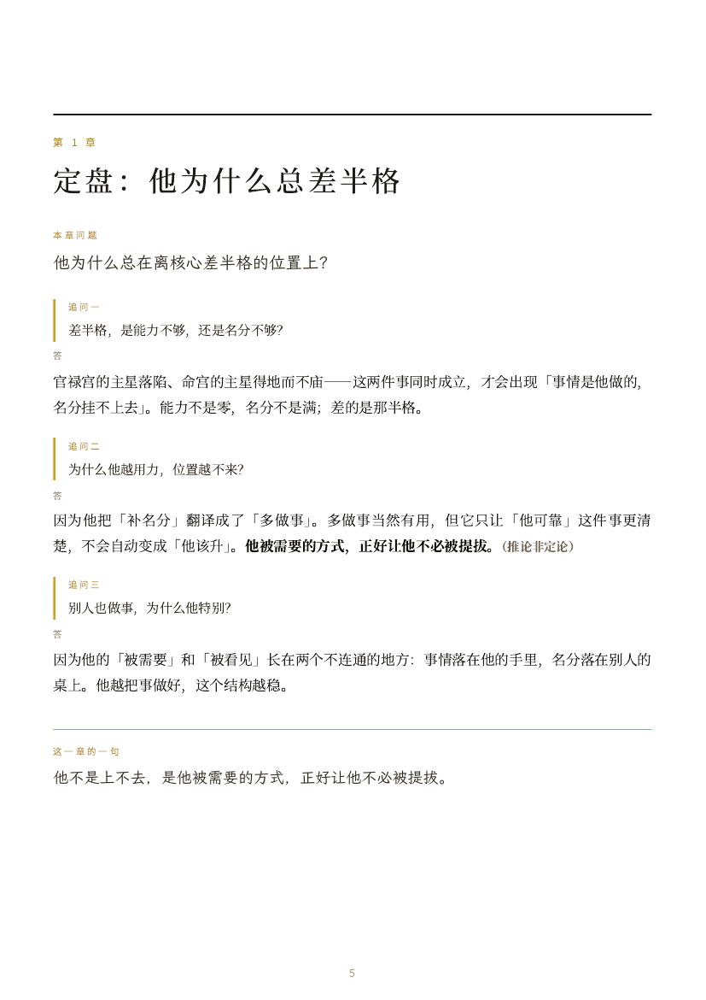
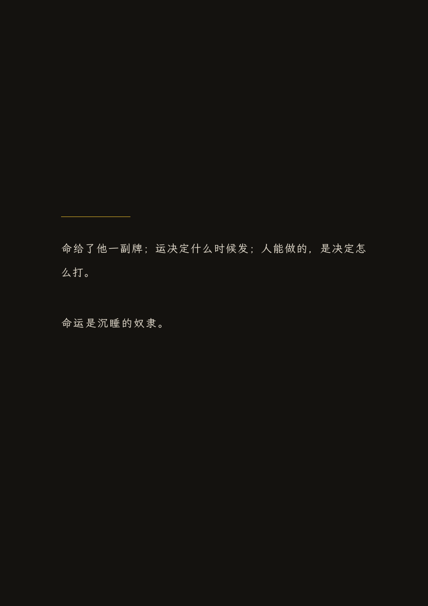

# slave

> `slave` 是项目名；技能名是 `wake_the_slave`。名字取自「命运是沉睡的奴隶」——看人和命运，谁是主人。

把一张或两张紫微斗数命盘，做成一本可打印、适合手机阅读的中文册子（PDF）。

> A Pi skill that turns Ziwei Doushu charts into a print-ready, mobile-friendly Chinese PDF booklet.

[](https://github.com/waterman995/slave/actions/workflows/ci.yml)
[](LICENSE)
[](https://github.com/waterman995/slave/releases)

## 这是什么

这是一个给 Pi 用的技能：输入出生信息，产出一本完整的紫微斗数册子——不是聊天里的一段回答，而是一本有封面、目录、章节、封底和附录的 PDF。

- **个人盘**：55–70 页。
- **合盘**：85–90 页，先写两个人的「人物卷」，再写「我们」的双人卷。
- **A4，正文 12pt**，每章新开一页，适合在手机上读。
- **固定章节**：定盘 / 健康 / 感情 / 事业与资产 / 运势 / 补充 / 命运叩问 / 金线与黑线 / 封底 / 附录。
- **盘是算的**：排盘来自确定性引擎，不靠模型记忆。
- **引文可查**：倪师原话带讲次/时间码；查不到出处的判断，明确标「（推论非定论）」。
- **三类表达分开**：盘面事实 / 通行读法 / 我的判断。

## 长什么样

| 封面 | 内页 | 封底 |
|---|---|---|
|  |  |  |

[示例 PDF](examples/sample.pdf)（7 页，只用虚构出生信息，展示版式，不是真实解读）。

## 给 agent 的一句话

把仓库链接和下面这句一起发给能运行命令的 agent：

> 读取 https://raw.githubusercontent.com/waterman995/slave/main/SKILL.md，严格照做。先把仓库克隆到 ~/.pi/agent/skills/wake_the_slave，运行 `bash ~/.pi/agent/skills/wake_the_slave/install.sh`；然后按 SKILL.md 给我做一本个人盘。我的出生信息是：……

只能读网页、不能运行命令的 agent：让它先读 `SKILL.md`，按规范写 Markdown 正文；不要假装能生成 PDF。

## 快速开始

### 1. 安装技能

```bash
git clone https://github.com/waterman995/slave.git \
  ~/.pi/agent/skills/wake_the_slave
```

也可以直接下载 ZIP，把整个目录放到 `~/.pi/agent/skills/wake_the_slave`。

### 2. 一键安装

```bash
bash ~/.pi/agent/skills/wake_the_slave/install.sh
```

它会依次做：装字体 → 拉上游引擎到 `~/ziwei-work` → 复制 CLI → 删掉 `server-only` → `npm install` → `selftest` → 环境检查。

需要：Node.js ≥ 20、Chromium 内核、poppler、Python 3、curl，以及三款中文字体：

- 正文：Noto Serif CJK SC
- 标签：Noto Sans CJK SC
- 封面/问句：LXGW WenKai **比例版**（不是 Mono）

`install.sh` 会装字体；系统工具缺了，`check-env.sh` 会给出按系统的安装命令。

### 3. 手动安装（可选）

想自己控制每一步：

```bash
cd ~/.pi/agent/skills/wake_the_slave

bash scripts/setup-fonts.sh
bash scripts/check-env.sh

git clone --depth 1 https://github.com/Renhuai123/ziwei-doushu.git ~/ziwei-work
cp assets/cli.ts assets/package.json ~/ziwei-work/

# 必须做：删掉 lib/ziwei/patterns.ts 和 lib/ziwei/famous.ts 里的
# import 'server-only'; 否则 CLI 会直接 throw。

cd ~/ziwei-work
npm install
npx tsx cli.ts --selftest
```

自检应显示四项全过。

### 4. 在 Pi 里用

```text
用 wake_the_slave 给这个人做个人盘：
公历 1990-01-01 12:00，北京，男。
PDF 放桌面。
```

合盘：

```text
用 wake_the_slave 做合盘：
他 1990-01-01 12:00，北京，男
她 1992-05-20 08:30，杭州，女
PDF 放桌面。
```

引擎和字体由 `install.sh` 准备好；之后每本册子复用缓存。具体排盘、章节、引证规则都在 `SKILL.md`。

## 目录结构

```text
SKILL.md                 技能入口：何时用、章节规范、写作规范、自检
AGENTS.md                给 agent 的安装/使用指令
llms.txt                 给 LLM 的仓库摘要
install.sh               一键装字体、拉引擎、跑 selftest
references/
  format.md              字体、CSS、HTML 骨架、PDF 生成、目录回填
  licenses.md            册子附录 D.5 的许可与致谢模板
scripts/
  setup-fonts.sh         装字体（用户目录，不需要 sudo）
  check-env.sh           只读环境探测；缺什么说清楚
  smoke-test.sh          煅烧：查旧术语、字体、分页、句子次数、封底顺序
  tocfill.py             目录页码自动回填
assets/
  cli.ts                 排盘 CLI（来自上游，MIT）
  package.json           依赖
examples/
  sample.html            版式样例（虚构出生信息）
  sample.pdf             样例 PDF
  cover.png / chapter.png / backcover.png
```

根目录还有 `README.md`、`LICENSE`、`NOTICE`、`CHANGELOG.md`、`CONTRIBUTING.md` 和 `.github/workflows/ci.yml`。

## 它是怎么工作的

1. **排盘**：上游引擎从出生日期、时辰、性别、经度算出十二宫、星曜、四化、大限、格局。
2. **取事实**：技能只读 CLI 的 JSON，不凭记忆排盘；排完核对三次。
3. **找引文**：本机有 1848 条倪师《天纪》原话（带讲次和时间码）和 75 段古籍精选；每个关键判断先查有没有出处。
4. **写判断**：模型把盘面字段、四化、大限和引文咬在一起；判断句里带依据，推断标「（推论非定论）」。
5. **排版**：HTML + CSS → Chromium → PDF；目录页码回填；字体门禁；每章新页。

**不使用**上游的 877 万段成品断语库。那套数据是上游 App 的输出，不是排盘数据；本技能靠盘面 + 原话 + 判断，不靠查表。

## 为什么册子长这样

- **12pt 正文**：大多数人在手机上看 PDF，10pt 太小。
- **章首问题 14pt、追问 11pt**：问题和追问要能一眼分开；章首问题不放在框里。
- **倪师原话酒红 + 斜体**：和古籍引文、正文判断区分开。
- **每章新开一页**：册子不是文章，章节要有呼吸。
- **附录在封底之后**：十个人里九个人不会看附录；封底是情绪的终点，附录是给愿意深看的人。
- **不做打印装订优化**：默认 PDF 分发；封底后接附录在 PDF 里成立。

## 常见问题

**为什么不做成聊天回答？**
聊天回答适合单点问题；册子适合完整读。章节、留白、封底、附录都是阅读的一部分。

**为什么合盘这么长？**
合盘要先把两个人各自写清楚，再写「我们」。人物卷七成写人、三成写关系；双人卷才是关系本身。页数目标 85–90；超了先压重复引证，不先压字号。

**为什么不能商用？**
册子大量引用倪海厦《天纪》原话，这部分是 CC BY-NC-SA 4.0，仅限非商业。要商用，先移除倪师引文，并自行评估其他内容。

**支持 Windows 吗？**
脚本是 bash；Windows 用 WSL 或 Git Bash。Chromium、poppler、Python 3 在 WSL 里按 Linux 的方式装。

**可以改章节吗？**
可以 fork。技能是 opinionated 的：章节顺序、三类表达、金线/黑线、命运叩问都是刻意固定的。改之前先读 `SKILL.md` 的 Contract。

**为什么没有用 877 万段解读数据集？**
它是上游的成品断语，不是排盘数据；用它会让册子变成断语汇编，而且每句无法回查。项目规模数字只在附录 D.5 里作背景。

## 许可

- 本仓库的代码与原创文字：**MIT**，见 [LICENSE](LICENSE)。
- 短引文：倪海厦《天纪》原话，**CC BY-NC-SA 4.0**，不在 MIT 范围内；引用处注明讲次/时间码。用这些引文生成的册子仅限非商业。
- 上游排盘引擎：**MIT**，Copyright (c) 2026 紫微研究；见 [NOTICE](NOTICE)。
- 古籍：**公有领域**。
- 上游 v4.0 解读数据集：**CC BY 4.0**；本仓库未包含、未使用。

## 致谢

- [Renhuai123/ziwei-doushu](https://github.com/Renhuai123/ziwei-doushu) 与作者王多鱼AI：排盘引擎、古籍、倪师语料。
- 倪海厦先生《天纪》：本技能最重要的读法来源。
- Noto Serif / Noto Sans CJK、LXGW WenKai：字体（OFL）。
- Chromium、poppler、Python：PDF 工具链。

## 免责声明

本册子是命理视角的文本演绎，不构成医疗、法律、投资建议，也不保证任何预测结果。「命运是沉睡的奴隶」是一个比喻，不是判决；怎么走，仍然由读的人决定。

## Contributing

欢迎 issue 和 PR。提交前请：

```bash
bash scripts/smoke-test.sh
bash scripts/smoke-test.sh --html examples/sample.html --pdf examples/sample.pdf
```

约定：

- 示例只用虚构出生信息，不放真实个人数据。
- 不改字体门禁：封面/问句不能是 Mono，正文不能低于 12pt。
- 不改章节骨架；要改，先开 issue 说明为什么。
- 新增引文必须带讲次/时间码；查不到就标「（推论非定论）」。
